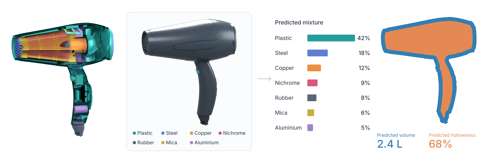
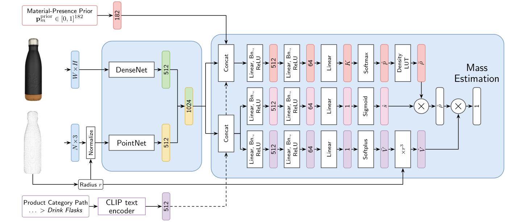

# EMMa-Composition-Mass-Estimator

Research code for **Predicting Material Mixtures from Material-Conditioned RGB Images for Physically Guided Mass Estimation**, approaching object mass estimation through material composition, volume, and a learned fill factor.

<!-- Add final authors and affiliation here. -->
<!-- Add links to the published paper and thesis when available. -->


*Concept illustration. The displayed proportions, volume, and hollowness are illustrative.*

## Method

The model combines an RGB image, a depth-derived point cloud, an EMMa material-presence prior, and optional category text embeddings. It predicts a material mixture, a fill factor, and volume, then computes mass as **volume × fill factor × mixture density**, using a material density lookup table. Physical consistency is further enforced through the normalized geometry, ensuring a cubic volume factor in dimensional transformations.



<!-- The repository includes scalar-density baselines and composition models. The study finds more inspectable intermediate predictions and consistent responses to geometric scale and material priors, but mixture models underperform the scalar-density baselines. Material proportions and fill factors are weakly supervised; they are not validated measurements of internal composition or occupancy.

For context, selected test-set results from the paper (lower ALDE is better) are:

| Model | Test ALDE ↓ |
| --- | ---: |
| B3 — Scalar density with material and text conditioning | **0.5999** |
| P2 — Material mixture with fill factor | 0.7884 |
| P3 — Material mixture with fill factor and text | 0.7508 | -->

## Setup and Data

The environment uses Python 3.10 and CUDA 12.6 PyTorch wheels on Linux/Windows. 

Install the project dependencies using [uv](https://docs.astral.sh/uv/). From the repository root, run:

```bash
git clone https://github.com/AltFLanca/EMMa-Composition-Mass-Estimator.git
cd EMMa-Composition-Mass-Estimator
uv sync --locked
cp configs/data.example.json configs/data.json
```

Finally, edit the `configs/data.json` with local paths to:

- The prepared EMMa v1.1 dataset, including category and material hierarchy metadata.
- Filtered ASIN splits, single-material subset, depth maps, foreground masks, text embeddings, and their valid ASIN lists.
- A material density lookup table, and optional density ranges for evaluation diagnostics.

**Artifact availability:** This is a **code-only release**. The EMMa data, generated augmentations, trained model checkpoints, and material density lookup table (LUT) are **not distributed** because of licensing considerations. Users must obtain or prepare compatible resources under the applicable terms. Consequently, the exact paper results cannot be reproduced from this repository alone.

## Training

[Experiment presets](configs/ablations) define the architecture, inputs, losses, and training settings:

| Family | Presets |
| --- | --- |
| Scalar density, with material/text conditioning | `b2.json`, `b3.json` |
| Scalar density with normalized geometry | `b2_rms.json`, `b3_rms.json` |
| Material mixture, without/with fill factor | `p1_frontier_rms.json`, `p2_frontier_rms.json` ||
| Material mixture with category text | `p3_frontier_rms.json` |

The remaining presets cover perception, geometry, supervision, and inherited-baseline ablations.

To train a scalar-density baseline with material conditioning and legacy geometry, run:

```bash
uv run train_baseline.py \
  --experiment configs/ablations/b2.json \
  --data configs/data.json
```

To train a composition model with fill factor, hierarchy-frontier supervision, normalized geometry, and $\lambda=0.3$, run:

```bash
uv run train_composition.py \
  --experiment configs/ablations/p2_frontier_rms.json \
  --data configs/data.json \
  --lambda-material 0.30
```

Additional tools used during model development for fitting [density activation](scripts/fit_density_bias.py) and checking [reciprocal-scale invariance](scripts/verify_c_invariance.py) are also provided.

## Inference and Evaluation

With a **locally trained checkpoint** and the required EMMa data and augmentations:

```bash
uv run inference.py \
  --checkpoint /path/to/best_model.ckpt \
  --data configs/data.json \
  --asins /path/to/asins.npy \
  --output predictions.csv
```

Omit `--asins` to use the configured test split. 

Inference runs on EMMa products identified by ASIN, using their precomputed depth/segmentation and optional text features, it is **not** a standalone arbitrary-RGB-image interface. The CSV includes ASIN, target and predicted mass (kg), predicted density (kg/m³), predicted volume (m³), fill factor where applicable, and the top predicted material label where available.

Use [evaluate_checkpoint.ipynb](notebooks/evaluation/evaluate_checkpoint.ipynb) for mass metrics, material agreement, scale consistency, fill-factor analysis, and material-prior counterfactuals.

## Companion repositories

| Repository | Role |
| --- | --- |
| [EMMa-Wrapper](https://github.com/AltFLanca/EMMa-Wrapper) | Dataset access, search, and augmentation storage |
| [ShapeNet-GLPDepth-Train](https://github.com/AltFLanca/ShapeNet-GLPDepth-Train) | GLPDepth Finetuning on ShapeNetSem |
| [EMMa-GLPDepth](https://github.com/AltFLanca/EMMa-GLPDepth) | GLPDepth depth augmentations |
| [EMMa-DepthAnythingV3](https://github.com/AltFLanca/EMMa-DepthAnythingV3) | Alternative DepthAnythingV3 depth augmentations |
| [EMMa-Thresholding-Masks](https://github.com/AltFLanca/EMMa-Thresholding-Masks) | Threshold-based foreground masks |
| [EMMa-SAM3](https://github.com/AltFLanca/EMMa-SAM3) | Alternative Text-prompted foreground masks with a thresholding fallback |
| [EMMa-CLIP](https://github.com/AltFLanca/EMMa-CLIP) | Category-path text embeddings |

Additional exploratory tools are available in [EMMa-DepthPro](https://github.com/AltFLanca/EMMa-DepthPro), [EMMa-GLiNER](https://github.com/AltFLanca/EMMa-GLiNER), and [EMMa-HDF5-Benchmark](https://github.com/AltFLanca/EMMa-HDF5-Benchmark).

<!-- Add the final citation/BibTeX here when publication details are available. -->